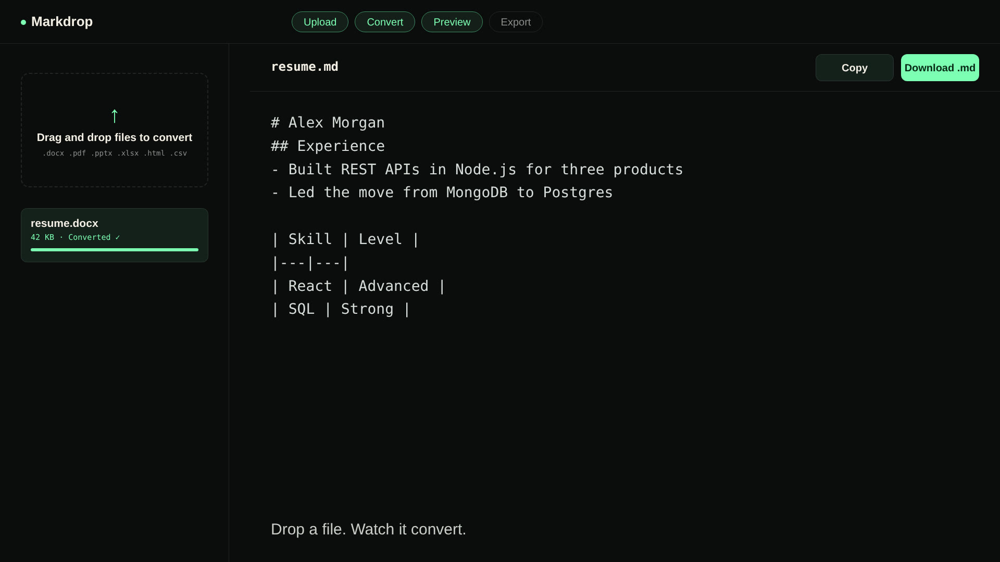

# Markdrop

Markdrop converts Word, PDF, PowerPoint, Excel, HTML and CSV files into clean Markdown in the browser. It uses Microsoft's [MarkItDown](https://github.com/microsoft/markitdown) as the conversion engine, with accounts that keep every user's files private.

**Live app:** https://mark-drop.vercel.app

## Walkthrough

[](docs/brag.mp4)

A 60-second tour: sign up, verify the email code, drop a file, convert it, preview the Markdown, then copy or download it.

## Stack

| Layer | Technology | Hosting |
|---|---|---|
| Frontend | React 18 + Vite | Vercel |
| Backend | Node.js + Express, runs MarkItDown | Render |
| Auth, database, storage | Supabase (Postgres, Auth, Storage, RLS) | Supabase |

## Project structure

```
markdrop/
  docs/           <- walkthrough video and poster
  Frontend/       <- React app
  Backend/
    server/       <- Node/Express API that runs MarkItDown
```

## Step 0 - Supabase project setup

1. Create a free project at supabase.com.
2. SQL Editor -> paste `Backend/server/schema.sql` -> Run.
3. Settings -> API -> copy the Project URL, `anon` key and `service_role` key. You'll put them in the two `.env` files below.

## Step 1 - Email delivery (required for OTP signup and password reset)

Supabase's built-in mailer doesn't allow template edits until custom SMTP is enabled. The recommended free option is Resend (resend.com), plugged into **Authentication -> Emails -> SMTP Settings**.

Then edit both templates under **Authentication -> Emails**:

- **Confirm sign up**: replace `{{ .ConfirmationURL }}` with `{{ .Token }}`, shown as plain text in the body rather than inside a link.
- **Reset password**: make the same swap.

The code length depends on your project's OTP settings (6 or 8 digits). The frontend accepts up to 8 digits, so either works without changes.

Also turn on **Authentication -> Sign In / Providers -> Email -> "Confirm email"**.

## Step 2 - Run the Frontend

```bash
cd Frontend
cp .env.example .env        # Windows PowerShell: copy .env.example .env
```

Fill in `.env` with your Supabase URL, anon key and `VITE_API_URL=http://localhost:8787`, then:

```bash
npm install
npm run dev
```

## Step 3 - Run the Backend

```bash
cd Backend/server
cp .env.example .env        # Windows PowerShell: copy .env.example .env
```

Fill in `.env` with your Supabase URL and service_role key, then:

```bash
npm install
pip install "markitdown[all]"       # Windows: py -m pip install "markitdown[all]"
npm run dev
```

The backend calls `markitdown` directly on Linux and macOS, and `py -m markitdown` on Windows.

## Step 4 - OAuth providers (optional)

Google and GitHub sign-in are enabled under **Authentication -> Sign In / Providers**. Each one needs its own OAuth client ID and secret from the provider.

Under **Authentication -> URL Configuration**, set:

- **Site URL**: your frontend URL (for example `https://mark-drop.vercel.app`)
- **Redirect URLs**: `https://your-frontend-domain/**` and `http://localhost:5173/**` for local development

## Deployment

### Backend on Render

| Setting | Value |
|---|---|
| Root directory | `Backend/server` |
| Build command | `npm install && pip install "markitdown[all]"` |
| Start command | `npm start` |
| Environment | `SUPABASE_URL`, `SUPABASE_SERVICE_ROLE_KEY` |

### Frontend on Vercel

| Setting | Value |
|---|---|
| Root directory | `Frontend` |
| Framework preset | Vite |
| Environment | `VITE_SUPABASE_URL`, `VITE_SUPABASE_ANON_KEY`, `VITE_API_URL` (your Render URL) |

`Frontend/vercel.json` rewrites all routes to `index.html`, so direct loads of `/app` work.

## Features

1. **Authorization**: Row Level Security in `schema.sql` means one user's files are never visible to another, whichever sign-in method they used.
2. **Sign in vs sign up**: sign-in goes straight to `/app`. Email/password sign-up goes through `/verify-otp` first. OAuth skips that step because the provider has already verified the email. Once signed in, the "Sign in" button becomes an avatar (`UserMenu.jsx`) showing the provider photo, or initials if there isn't one.
3. **Live validation**: email format and a four-rule password checklist update as you type (`utils/validation.js`, `components/FieldHint.jsx`).
4. **Signup OTP** (`/verify-otp`): a new account must confirm its emailed code before it can log in.
5. **Forgot password OTP** (`/forgot-password`): email -> code -> new password -> back to sign-in.
6. **Dark and light theme**: toggled from the navbar and remembered in the browser.

## Security notes

- The service role key lives only in `Backend/server/.env`, never in the frontend or in git. Only `.env.example` files are committed.
- The backend caps uploads at 25MB (multer config in `server/index.js`).
- `cors()` in `server/index.js` currently allows all origins. Restrict it to your frontend domain before wider use.

## Known limitations

- Render's free tier sleeps when idle, so the first request after a pause takes about 50 seconds.
- Resend's shared `onboarding@resend.dev` sender only delivers to the account owner's own email. Real multi-user email needs your own verified domain.
- Output quality depends on MarkItDown itself. Messy tables and headings are passed through as-is.